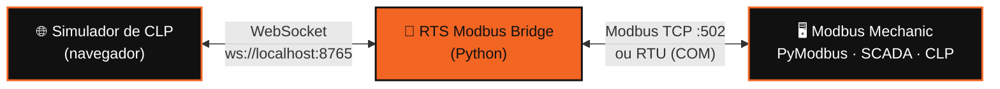

<div align="center">



<br>

<picture>
  <source media="(prefers-color-scheme: dark)" srcset="assets/logo-rts-dark.png">
  
</picture>

### ⚡ Ferramentas gratuitas para testar, simular e integrar CLPs via Modbus

**Baixe, execute e conecte em minutos — sem cadastro, sem licença, sem complicação.**

<br>

[](https://github.com/LaPumia1/rts-downloads/releases/latest)
[](https://github.com/LaPumia1/rts-downloads/releases)
[](#-ferramentas-disponíveis)
[](https://www.python.org/downloads/)
[](#-começando-em-3-passos)

<br>

<a href="https://github.com/LaPumia1/rts-downloads/releases/latest">
  
</a>
&nbsp;
<a href="https://www.rtseletrica.com.br/">
  
</a>

</div>

<br>

---

## 🧰 Ferramentas disponíveis

<table>
<tr>
<td width="50%" valign="top">

### 🖥️ PyModbus

**Mestre e escravo Modbus com interface gráfica.**

Atue como **cliente/mestre** (TCP ou RTU) para ler e escrever em qualquer equipamento, ou **simule um servidor Modbus** completo com banco de memória editável — perfeito para testar sem ter o CLP na bancada.

- ✅ Modbus **TCP** e **RTU** (serial)
- ✅ Modo **mestre** e modo **servidor**
- ✅ Memória editável em tempo real
- ✅ Interface gráfica, sem linha de comando

<p align="center">
<a href="https://github.com/LaPumia1/rts-downloads/releases/latest/download/PyModbus.rar"></a>
</p>

</td>
<td width="50%" valign="top">

### 🔌 RTS Modbus Bridge

**Liga o Simulador de CLP do site a um servidor Modbus real.**

Tudo que você muda no **Simulador de CLP Modbus** aparece no servidor Modbus — e tudo que um master externo escreve volta para a página, **ao vivo**.

- ✅ Compatível com **Modbus Mechanic** e outros masters
- ✅ Coils, entradas discretas, input e holding registers
- ✅ Sincronização bidirecional instantânea
- ✅ Leve: apenas ~15 KB em Python puro

<p align="center">
<a href="https://github.com/LaPumia1/rts-downloads/releases/latest/download/rts_modbus_bridge.zip"></a>
</p>

</td>
</tr>
</table>

---

## 🔄 Como a ponte funciona



---

## 🚀 Começando em 3 passos

> [!TIP]
> Precisa apenas do **[Python 3.9 ou mais novo](https://www.python.org/downloads/)** instalado (marque *“Add Python to PATH”* na instalação).

**1️⃣ Instale as dependências** (só na primeira vez), dentro da pasta extraída:

```bash
pip install -r requirements.txt
```

**2️⃣ Inicie a ponte** e deixe a janela aberta:

```bash
python rts_modbus_bridge.py
```

```text
Pagina web (WebSocket): ws://localhost:8765
Servidor Modbus TCP:    0.0.0.0:502
```

**3️⃣ Conecte tudo:**

| Onde | O que fazer |
|---|---|
| 🌐 **Simulador de CLP** | Abra ou recarregue (`F5`) a página — deve aparecer **🟢 Conectado à ponte Modbus local** |
| 🖥️ **Modbus Mechanic / master** | IP **`127.0.0.1`** (ou o IP do PC na rede) · Porta **`502`** · Slave ID **`1`** |

> [!IMPORTANT]
> No Windows, a porta **502** pode exigir executar o terminal **como Administrador**. Se o firewall perguntar, permita o acesso na rede privada.

---

## ❓ Dúvidas frequentes

<details>
<summary><b>Como abro o arquivo <code>.rar</code>?</b></summary>
<br>
Use o <a href="https://www.7-zip.org/">7-Zip</a> (gratuito) ou o WinRAR. No Windows 11 atualizado, o próprio Explorador de Arquivos já abre <code>.rar</code>.
</details>

<details>
<summary><b>O simulador não mostra “Conectado à ponte”.</b></summary>
<br>
Confira se a janela do <code>rts_modbus_bridge.py</code> continua aberta e sem erros, e recarregue a página com <code>F5</code>. A ponte usa a porta <code>8765</code> — ela não pode estar em uso por outro programa.
</details>

<details>
<summary><b>Posso usar Modbus RTU (serial) em vez de TCP?</b></summary>
<br>
Sim. Edite a variável <code>RTU_PORT</code> no início do <code>rts_modbus_bridge.py</code> (ex.: <code>"COM3"</code> no Windows ou <code>"/dev/ttyUSB0"</code> no Linux).
</details>

<details>
<summary><b>Dá para acessar a ponte de outro computador?</b></summary>
<br>
Sim. O servidor escuta em <code>0.0.0.0:502</code>; basta usar o IP da máquina onde a ponte está rodando, na mesma rede.
</details>

---

## 🏭 Sobre a RTS

<table>
<tr>
<td width="120" align="center">
<picture>
  <source media="(prefers-color-scheme: dark)" srcset="assets/logo-rts-dark.png">
  
</picture>
</td>
<td>

**RTS Soluções em Elétrica e Automação** — manutenção preventiva em máquinas industriais, montagem de painéis elétricos, SPDA, programação de CLP e desenvolvimento de software para automação.

🌐 [rtseletrica.com.br](https://www.rtseletrica.com.br/) &nbsp;·&nbsp; ✉️ [comercial@rtseletrica.com.br](mailto:comercial@rtseletrica.com.br)

</td>
</tr>
</table>

<div align="center">

<br>

**Gostou das ferramentas? Deixe uma ⭐ no repositório!**

<sub>Feito com ⚙️ e ⚡ pela equipe RTS</sub>

</div>
